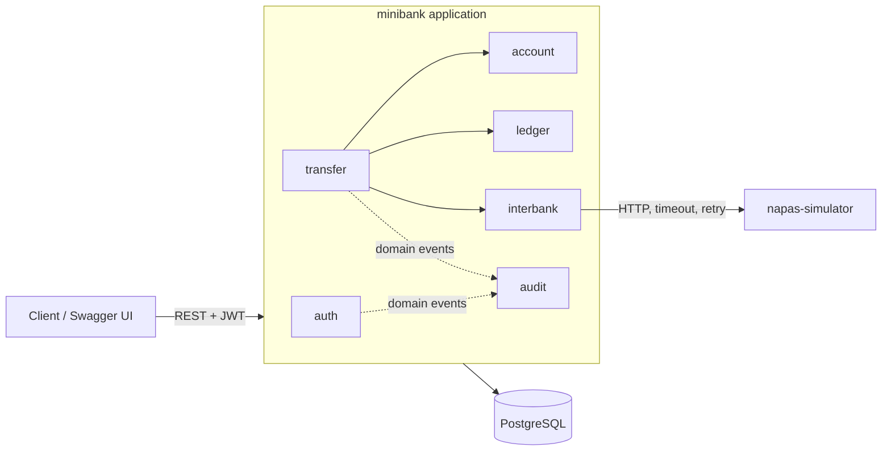
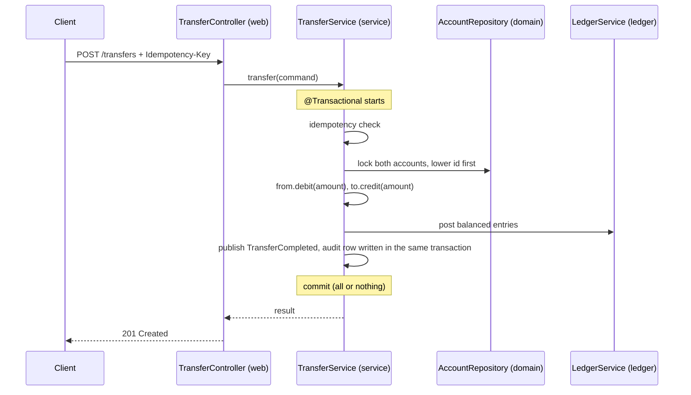

# Architecture

Mini Bank is a **modular monolith**: one deployable Spring Boot application,
split into feature modules with enforced boundaries, plus one small external
simulator for the interbank network. See [ADR 0002](adr/0002-modular-monolith-and-patterns.md)
for why.

## System view



## Modules

| Module | Responsibility |
|---|---|
| `auth` | Registration, login, JWT issuing and validation |
| `account` | Opening accounts, balances, ownership checks |
| `transfer` | Deposits, withdrawals, internal and interbank transfers, idempotency |
| `ledger` | Double-entry journal; source of truth for every money movement |
| `interbank` | Port and adapter to the external network (Napas simulator) |
| `audit` | Append-only log of sensitive actions, fed by domain events |
| `common` | Shared building blocks only: `Money`, error handling, base config |

## Layers inside a module

```
com.minibank.<module>
├── web        controllers, request/response DTOs (records)
├── service    use cases, transaction boundaries (@Transactional)
├── domain     entities, value objects, domain exceptions,
│              repository interfaces, ports to the outside world
└── infra      adapters for external systems (HTTP clients, etc.)
```

Dependency rules, enforced by `ArchitectureTest` (ArchUnit) on every build:

1. `web → service → domain`. Controllers never touch repositories.
2. `domain` depends on nothing in `web`, `service` or `infra`, and not on
   Spring MVC.
3. `infra` implements ports declared in `domain`; nothing calls `infra`
   directly, Spring wires it in.
4. A module's `web` and `infra` are private to it. Modules talk through
   services, domain types and events.
5. No dependency cycles between modules. `common` depends on no module:
   domain exceptions extend a base exception in `common` that carries the
   error code and HTTP status, so the global handler never imports a module.
   Callbacks that would point backwards (e.g. interbank result → transfer)
   go through events.
6. No `float`/`double` fields anywhere, DTOs included. No `java.util.Date`;
   JWTs are built with Spring Security's `JwtClaimsSet`, which uses `Instant`.
7. Constructor injection only: no field injection (`@Autowired`, `@Value`,
   `@Inject`, `@Resource` on fields).

Configuration classes (security config, the JWT filter, bean wiring) live in
`<module>.config` and sit outside the four layers.

## Request flow: internal transfer



## Design patterns, and the problem each one solves

A pattern is only used where it removes a real problem. Each row is the
answer to "why is this here?" in an interview.

| Pattern | Problem it solves | Where | Phase |
|---|---|---|---|
| Layered architecture + package by feature | Keep features independent and code easy to find | Whole app | 0 |
| Repository | Keep SQL details out of business logic | `*.domain.*Repository` (Spring Data) | 1 |
| DTO | Never expose entities or internal fields over HTTP | `*.web` records | 1 |
| Value Object | Money arithmetic and validation in one place, not scattered `BigDecimal` | `common.Money` | 1 |
| Rich domain model | Balance rules live with the data: `account.debit()` rejects overdraft | `account.domain.Account` | 1 |
| Chain of Responsibility | Authenticate every request before it reaches a controller | Our JWT filter, plugged into Spring Security's filter chain | 1 |
| Strategy | Internal and interbank transfers share one entry point but differ in execution | `TransferExecutor` per transfer type | 3 |
| State | Interbank transfer moves through `PENDING → SUCCESS / FAILED → REFUNDED` with legal transitions only | `InterbankTransfer` status transitions | 3 |
| Ports and Adapters | Swap the real network client for a fake in tests; isolate HTTP details | `interbank.domain.NetworkGateway` + `infra` adapter | 3 |
| Observer (domain events) | Audit log without coupling every service to the audit module | Spring `ApplicationEvent` + synchronous listener inside the same transaction, so an audit row is never lost (an `AFTER_COMMIT` listener could lose it on crash) | 2 |
| Idempotency key | A retried or double-clicked request must not move money twice | `transfer` module | 2 |
| Retry with backoff, timeout | The external network is slow or flaky | `interbank.infra` | 3 |
| Test Data Builder | Readable tests without long constructors | `src/test` | 1 |

Patterns deliberately **not** used: generic `BaseService<T>`, abstract
factories with one implementation, CQRS, event sourcing, microservices. They
add indirection this project cannot justify.

## Clean code rules

- Names say intent: `withdraw`, `InsufficientFundsException`, not `process`,
  `handle`, `Utils`.
- Small methods that do one thing; a service method reads like the use case.
- Immutability by default: records for DTOs, value objects and commands.
- No public setters for balance or status; state changes go through domain
  methods that check invariants.
- Errors are domain exceptions, mapped to RFC 9457 problem details in one
  global handler.
- No magic numbers or strings; name them.
- Comments explain *why*, never *what*.
- Formatting is automatic (Spotless with Palantir Java Format) and checked in CI.
